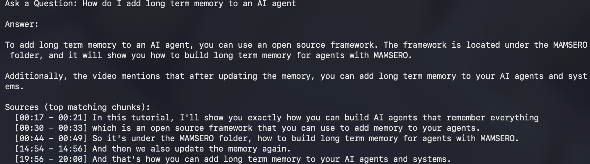

# RAG-based AI Teaching Assistant for Videos

Ask questions about your own videos and get answers that cite the exact timestamps.
Everything runs locally: Whisper for transcription, Ollama for embeddings (`bge-m3`) and answers (`llama3.2`).

## How it works

```
video -> mp3 -> Whisper transcript chunks (with timestamps) -> bge-m3 embeddings
      -> cosine similarity (top 5 chunks) -> LLM answer with timestamp citations
```

## Requirements

- Python 3.10+
- [ffmpeg](https://ffmpeg.org/) (`brew install ffmpeg` on macOS)
- [Ollama](https://ollama.com/) running locally

```bash
ollama pull bge-m3
ollama pull llama3.2
pip install -r requirements.txt
```

## Usage

1. **Add your videos.** Put your own video files in the `video/` folder.
2. **Convert to mp3.** `python video_to_mp3.py` (writes to `audios/`)
3. **Transcribe.** `python mp3_to_json.py` (writes one JSON per mp3 to `jsons/`).
   By default it assumes Hindi audio and translates to English. Change `LANGUAGE` and `TASK` at the top of the file to suit your video.
4. **Create embeddings.** `python preprocessed_json.py` (saves `embedding.joblib`)
5. **Ask questions.** `python process_incoming.py`

The prompt sent to the LLM is saved to `prompt.txt` and the answer to `response.txt` for debugging.

## Example



Note: Whisper sometimes mis-transcribes "mem0" as "MAMSERO". Setting `initial_prompt` in `mp3_to_json.py` can improve this.

## Notes

- Videos, audio, transcripts and embeddings are git-ignored on purpose. Only use content you have the right to use.
- Whisper chunks are short (a few seconds each). Merging them into longer chunks can improve retrieval quality.
